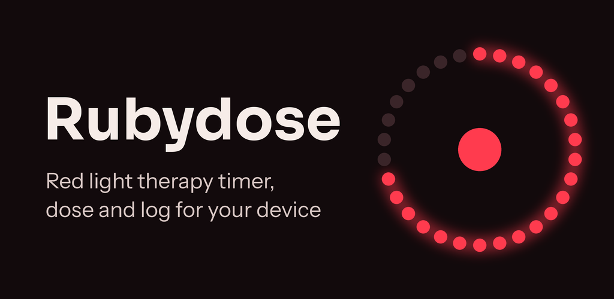
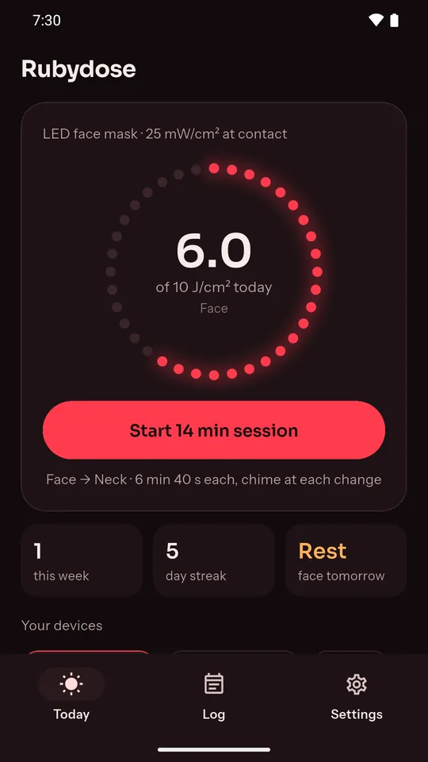
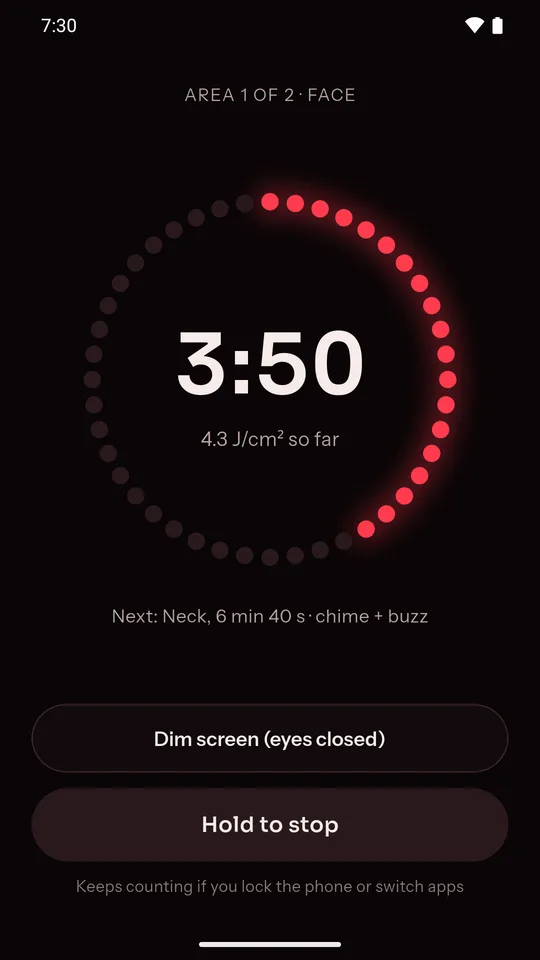
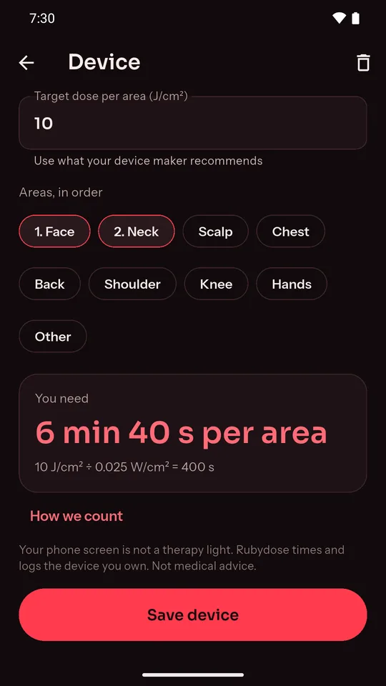

# Rubydose: Red Light Therapy

A free red light therapy timer, dose calculator and log for Android, for the LED face mask or red light panel you already own.

## What it does

- **Minutes from your device's numbers.** Enter the irradiance your maker quotes (mW/cm²) and your target dose (J/cm²). Rubydose shows the minutes per area and writes the sum out, so you can check it.
- **A timer for closed eyes.** Pick the areas in order. A chime and a buzz tell you when to move the light, and dim mode turns the screen almost black.
- **Keeps the right time.** The countdown carries on if you lock the phone, switch apps or Android closes the app.
- **A log that keeps you consistent.** Every session is saved with device, areas and dose. See days per area this week, your streak, and a nudge after 4 days in a row on one area.
- **Several devices.** A profile for each light: mask, panel, wand, hair cap or pad.
- **Private by design.** No account, works offline, and before/after photos never leave the phone.

Your phone screen is not a therapy light; Rubydose times and logs the device you own. It is a timer and log, not a medical device, and does not treat or diagnose anything.

## Links

- Website: https://rubydose.pages.dev/
- Privacy policy: https://rubydose.pages.dev/privacy/
- Teaser video: https://youtube.com/shorts/KG0-scRpVLs
- Support: anithabheesetty@gmail.com
- More apps from NK Tools: https://play.google.com/store/apps/developer?id=NK+Tools

© 2026 NK Tools. All rights reserved.
